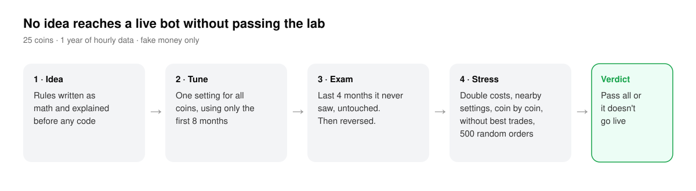

# Trading Bot Lab

> An experiment in running automated decisions responsibly: three crypto trading bots in the cloud, with fake money, and a validation lab that every idea has to pass before it touches a live bot.

  
  
  

This repository is a **portfolio showcase**. The code and the strategies stay private.

| | |
|---|---|
| **Goal** | Learn how to evaluate an automated strategy honestly, not make money. Most trading bots look great on past data and fail live; the point here is to build the process that catches that before it costs anything. |
| **Role** | Product owner: defined the goal, the rules of the game, the validation criteria and every go / no-go decision. Built by directing an AI coding agent (Claude Code). |
| **Setup** | Runs in the cloud every minute (nothing on a personal computer), with a private dashboard and Telegram alerts. Only test accounts and simulated money. |
| **Status** | **In progress.** Three bots running in paper mode. No strategy is cleared for real money: they need months of live track record first. |

---

## The validation lab

An idea **passes only if it clears every check**: enough trades in the exam, profit after costs, still profitable with costs doubled, wins in most coins and with nearby settings, survives removing its 5 best trades, and works when the exam is reversed. Since November 2026 it also has to lose in no more than 5% of 500 portfolio simulations with random order.

## What happened so far

| Step | Result | Decision |
|---|---|---|
| **Rules v1** (first prompt, written with ChatGPT and reviewed) | 3 years of backtest: −17.9% vs +73.7% for buy and hold. It lost even with zero fees, so the signal had no edge. | **Discarded** before testnet. |
| **Rules v2** (4-hour breakout) | Passed the first exam: much smaller drawdowns than holding (8.9% vs 53.5% on BTC), but fewer gains in bull markets. | Moved to a live test with fake money. |
| **Trend bot** | Looked good at first; with a corrected portfolio test it **did not pass** the lab. | Kept running on paper **only as an observation**, flagged as not validated. |

The most useful outcome so far is not a strategy: it is a repeatable process that says **no** quickly and with evidence, and a log of every decision, every mistake and how it was corrected.

## How it runs

- **Scheduler → cloud function → database**, every minute: read market prices, decide, record the trade, alert.
- Market data from public read-only sources; orders only against a test exchange or in paper mode.
- Safety rules in the code: no withdrawals, no margin, no futures; pause after consecutive losses or a daily loss limit; keys stored as cloud secrets that the AI agent never sees.
- Private dashboard to follow each bot and pause it.

## What's next

- Collect real trades from the bots for several months.
- Only ideas that pass the lab get a live bot; real money stays off the table until the live track record agrees with the lab.

---

Made by **Jonathan Godoy** · Project manager working with AI · [jonathangodoy.xyz](https://jonathangodoy.xyz) · [GitHub](https://github.com/JonGod22)
